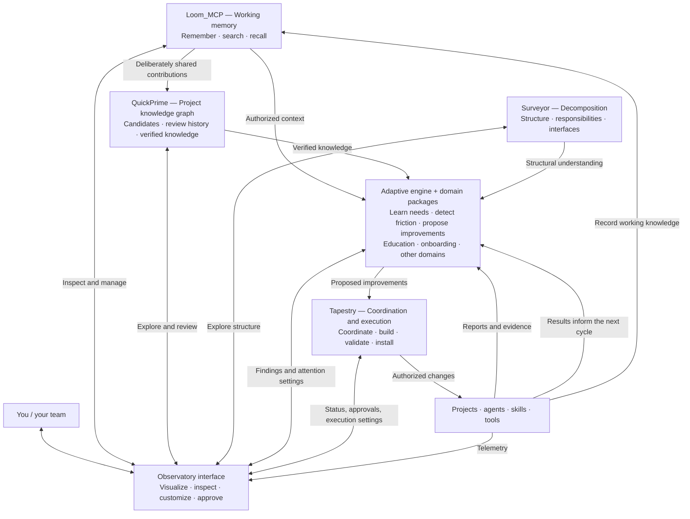

# Target architecture: six modules

**Status:** the agreed target (operator, 2026-11-09). Recorded in loom memory as
`decision-target-architecture-six-modules-2026-11-09`. It supersedes the earlier five-component
drafts of the same day and the layer descriptions in [`observatories.md`](observatories.md).
Which existing code goes to which module, and what is missing, is in the implementation map:
`surveyor/docs/decomposition/2026-11-09-implementation-map.md`. This doc moves to the
observatory interface's repo once its home is chosen.

The system has **six modules**. Personal and team use share implementations, while their data
and permissions remain separate. Domains (education, onboarding, project work) configure the
adaptive engine.

| Module | Owns | Repo direction |
|---|---|---|
| **Working memory** | Recording, retrieval, recall, and search. Supports personal and team instances. | **Loom_MCP** |
| **Verified project knowledge** | Admission of contributions, supporting evidence, review decisions, accepted knowledge, relationships, and version history. | **QuickPrime** |
| **Adaptive engine + domains** | Watching authorized evidence, learning needs, identifying friction, and proposing improvements. Domain packages supply specialized rules and methods. | Consolidate the relevant **Lens and education-lab machinery**; retain education as a domain inside it. Repo name remains open. |
| **Observatory interface** | Visualization, exploration, customization, review, and controls across the system. | **Separate module**; repo home remains open. |
| **Decomposition** | Discovering structure, assigning responsibilities, defining interfaces, and evaluating architectural changes. | **Surveyor** |
| **Coordination and execution** | Connecting components, equipping agents, scheduling work, and carrying authorized changes through validation and installation. | **Tapestry** |

## What you control through the observatory

- **Attention:** what gets watched, how often, investigation depth, and notification thresholds.
- **Adaptation:** which domain rules apply, what triggers skill creation, and how improvements
  are evaluated.
- **Authority:** what runs automatically, what needs review, and what requires approval.
- **Access:** which personal or project information each component may use.
- **Knowledge review:** inspect contributions and evidence before accepting them into
  QuickPrime.

The interface sends those settings to the module responsible for enforcing them:
- the adaptive engine obeys attention and domain settings;
- Tapestry enforces execution permissions;
- Memory and QuickPrime enforce access to their data.

## How the loop works

Suppose a team repeatedly struggles with handoffs:

1. Project activity produces telemetry and reports.
2. The adaptive engine identifies the recurring problem using the relevant domain rules,
   authorized memory, and Surveyor's structural understanding.
3. The observatory shows the evidence and proposed improvement.
4. Tapestry builds, validates, and installs the authorized change, for example a handoff skill.
5. Later activity shows whether the change helped. That evidence feeds the next adaptation
   cycle.
6. Loom_MCP remembers the outcome. Selected project knowledge can be reviewed and accepted into
   QuickPrime.

**Personal versus team is a scope distinction; education versus onboarding is a domain
distinction.** The observatory can present either scope, and the adaptive engine can use
multiple domains. QuickPrime specifically serves verified **project** knowledge; the personal
layer does not need its own equivalent.

This is the target architecture. The next implementation map must assign existing code to these
six homes and identify the missing pieces without treating current repo boundaries as fixed.
