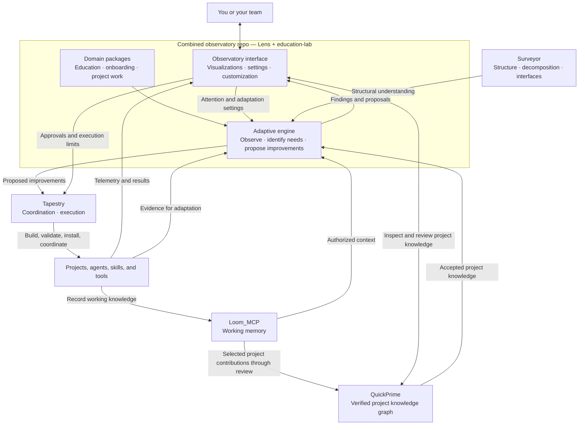

# Target architecture: the five components

**Status:** agreed by the operator, 2026-11-09. This is the target. The existing repos hold parts
of it; consolidation, the full observatory controls and the closed adaptation loop still need
building. Recorded in loom memory as `decision-target-architecture-five-components-2026-11-09`.
Supersedes the layer descriptions in [`observatories.md`](observatories.md) where they differ.
This doc moves to the combined observatory repo once its home and name are chosen.

The whole system has **five components**, with the observatory providing the interface through
which you see and adjust it.

| Component / repo | What it owns |
|---|---|
| **Loom_MCP** | Working memory: record, recall, search, and retrieve knowledge. The same implementation can serve separate personal and team instances. |
| **QuickPrime** | The **project's verified knowledge graph**: contributions, evidence, review decisions, accepted knowledge, relationships, and history. No personal equivalent is required. |
| **Combined Lens + education-lab** (name to settle) | The **observatory interface**, **adaptive engine**, and **domain packages**. Shows what is happening, lets you adjust behavior, learns needs, and proposes improvements. |
| **Surveyor** | Structural understanding: decomposes systems, identifies responsibilities and interfaces, and evaluates where functions belong. |
| **Tapestry** | Central coordination and execution: connects the components, equips agents, and builds, validates, installs, or rolls back authorized improvements. |

## Control

The observatory is where you control:
- attention;
- frequency;
- notifications;
- skill creation;
- review requirements;
- automation levels;
- information access.

Its settings govern the adaptive engine; Tapestry enforces the authority to act.

## An example of the loop

1. Repeated confusion during a course task produces evidence.
2. The adaptive engine interprets it using the education domain's rules and proposes a change
   to a teaching skill.
3. You inspect the evidence and the proposal in the observatory.
4. Tapestry applies the change within your permissions.
5. Later telemetry shows whether it helped.
6. Loom_MCP remembers the outcome.

Knowledge deliberately contributed to a project can enter QuickPrime through review.

## Domain and scope are separate

- **Domain:** education or onboarding decides the rules used to interpret needs.
- **Scope:** personal or project decides whose information is accessible and who controls the
  settings.
- Sharing the implementation never automatically shares private data.

## What exists today versus this target

Source: Surveyor evaluation 4,
`surveyor/docs/decomposition/evaluations/2026-11-09-five-components-and-the-adaptive-layer.md`.

| Part | Today |
|---|---|
| Loom_MCP working memory | Live (personal). The team-instance capability is not yet built. Production moves from Tapestry at step P3. |
| QuickPrime graph | Design and research only. It plans to use the spine (lens-core standard 0.2.0) as its store. |
| Observatory interface | The Lens has none. Tapestry's web dashboard and observatory console exist and are proposed to move to the combined repo. |
| Adaptive engine | Four separate watch, learn, propose loops: education-lab harvest and triage, Tapestry self-observer, Tapestry signal engine, and lens-observe (a stub). Nothing on a timer reads Loom_MCP. |
| Domain packages | Education is working in education-lab (learning rules, triage, plugins). The others are not started. |
| Surveyor | Working: method, lens-log, evaluations. |
| Tapestry execution | Not built. Tapestry proposes and records today; policy does not apply changes. |
| Observatory controls | Not built. |
